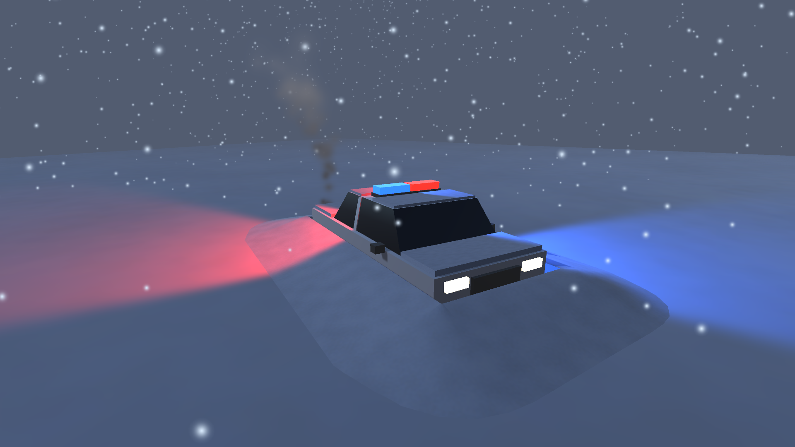

# Unity Taller Invierno — Paredes

Taller práctico de Unity: escena invernal de rescate. Una patrulla de policía quedó semienterrada en la nieve durante una tormenta; el motor sigue encendido y las sirenas giran.



## Versión

- Unity 6 (6000.6.6f1), Built-in Render Pipeline

## Jerarquía de la escena

```
Main Camera
Moon_Light          (Directional Light azul pálido, intensidad 0.35)
Snow_Terrain        (Plane con material de nieve)
Police_Car          (Empty, Y = -0.5 para simular que está enterrado)
├── Car_Mesh        (Modelo 3D de la patrulla, un solo mesh)
├── Siren_Pivot     (Empty en el techo, con SirenRotation.cs)
│   ├── Red_Light   (Spot Light roja)
│   └── Blue_Light  (Spot Light azul, orientada al lado opuesto)
└── Exhaust_Smoke   (Particle System, humo del escape)
Global_Blizzard     (Particle System, nieve sobre toda la escena)
```

## Modelo de la patrulla

`Car_Mesh` usa un modelo propio (`Assets/Models/Patrulla.asset`) construido como un único mesh con varios materiales, así la jerarquía sigue teniendo exactamente 10 objetos. Incluye carrocería blanca con franja azul y puertas negras, cabina con vidrios inclinados, barra de luces roja y azul con emisión, faros, pilotos, parachoques, espejos, nieve acumulada sobre el capó y el techo, y una duna de nieve alrededor que lo deja semienterrado.

## Script `SirenRotation.cs`

Asignado solo a `Siren_Pivot`. Expone `rotationSpeed` (grados por segundo) en el Inspector y gira el pivote en `Update()` con `Transform.Rotate()` multiplicado por `Time.deltaTime`, así la velocidad es la misma con cualquier FPS. Las luces roja y azul son hijas del pivote, por eso giran en círculo con él.

## Sistemas de partículas

- **Global_Blizzard:** Shape *Box* de 40×40 a 12 m de altura, emitiendo hacia abajo. Gravedad 0.25, velocidad inicial variable (1.5 a 4), color azul muy claro, viento lateral (*Velocity over Lifetime*) y *Noise* para las ráfagas.
- **Exhaust_Smoke:** Shape *Cone* estrecho (6°) en la parte trasera del coche. *Color over Lifetime* de gris oscuro a transparente y *Size over Lifetime* creciente. La emisión sigue una curva irregular con una ráfaga extra, para que parezca que el motor tose por el frío.

## Ambiente

Iluminación ambiental azul oscuro y niebla exponencial para la sensación de tormenta nocturna.

## Cómo abrirlo

En Unity Hub: **Add → Add project from disk**, seleccionar esta carpeta y abrir `Assets/Scenes/EscenaInvernal.unity`. Pulsar **Play** para ver girar las sirenas y caer la nieve.
